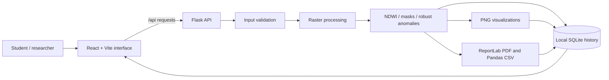

# HydroScan AI

HydroScan AI is a local-first engineering project for inspecting aligned Sentinel-2-style GeoTIFF bands around a study area such as the Godavari near Nashik. It calculates NDWI candidate-water masks, transparent robust spectral outlier priorities, visual comparisons, and downloadable PDF/CSV reports. It is a screening and learning tool, not a water-quality measurement system.

## Run locally on Windows 10/11 (PowerShell)

Use Python 3.12, Node.js 20 or newer, and pnpm. Open two PowerShell terminals from the workspace root.

### 1. Install the Python environment once

```powershell
py -3.12 -m venv .venv
.\.venv\Scripts\Activate.ps1
python -m pip install --upgrade pip
python -m pip install -r requirements.txt
```

### 2. Start the Flask API (terminal 1)

```powershell
.\.venv\Scripts\Activate.ps1
$env:PORT = "8080"
python artifacts\hydroscan-ai\backend\app.py
```

### 3. Install frontend packages and start Vite (terminal 2)

```powershell
corepack enable
pnpm install
$env:PORT = "5173"
$env:BASE_PATH = "/"
$env:HYDROSCAN_LOCAL_API_TARGET = "http://127.0.0.1:8080"
pnpm --filter @workspace/hydroscan-ai run dev
```

Open the address printed by Vite, normally `http://localhost:5173`. The local-only Vite proxy forwards `/api` to Flask. The Replit preview uses its shared service router and does not set `HYDROSCAN_LOCAL_API_TARGET`.

Stop both servers with `Ctrl+C`. Local SQLite records, uploaded source bands, generated image layers, and PDFs are stored under `artifacts/hydroscan-ai/data/`. That folder is excluded from Git and deployments. Set `HYDROSCAN_DATA_DIR` before starting Flask if you want another local storage location.

## Run in this Replit project

The configured `artifacts/api-server: API Server` workflow starts the Flask API, and `artifacts/hydroscan-ai: web` starts the React/Vite interface. Start both workflows to use the app preview. The generated API client and OpenAPI contract live in the workspace shared libraries.

## Uploading satellite bands

For real analysis, upload one **single-band GeoTIFF** for each Sentinel-2 band:

| App field | Sentinel-2 band | Typical role |
| --- | --- | --- |
| Blue | B02 | Visible blue |
| Green | B03 | NDWI green channel |
| Red | B04 | Visible red |
| Near-infrared | B08 | NDWI near-infrared channel |

All four rasters must have exactly matching width, height, CRS, and affine transform. HydroScan does not silently resample or align them. Clip the four rasters to the same study-area extent before upload; the API enforces a pixel and request-size ceiling to avoid exhausting memory with full-scene inputs. The app reports the file dimensions, data types, resolution, CRS, valid-pixel coverage, and nodata limitations.

The app does not fetch or download Sentinel-2 scenes. It does not independently verify file provenance, observation dates, cloud conditions, or a river boundary. Use the study-area label and observation date only when they accurately describe the uploaded data.

## Project structure

```text
artifacts/
  api-server/                 Existing API service workflow; starts Flask
  hydroscan-ai/
    backend/
      app.py                  Flask routes, validation, reports and history
      processing.py           Raster validation, NDWI, mask and anomaly methods
      storage.py              Local SQLite analysis history
      reports.py              PDF report generation
      tests/                  Formula, input-validation and API tests
    src/                      Responsive web interface
    data/                     Local-only uploads and generated results (ignored)
lib/
  api-spec/openapi.yaml       API source contract
  api-client-react/           Generated typed React Query client
  api-zod/                    Generated Zod schemas
requirements.txt              Windows/local Python dependencies
```

## System architecture



## Method and assumptions

Read [methodology.md](docs/methodology.md) for the equations, thresholds, assumptions, limits, and extension ideas. Read [viva-guide.md](docs/viva-guide.md) for the module walkthrough and likely engineering viva questions. A repeatable walkthrough is in [demo-walkthrough.md](docs/demo-walkthrough.md).

## Tests

Run the backend unit and Flask route tests from the workspace root:

```powershell
.\.venv\Scripts\Activate.ps1
python -m unittest discover -s artifacts\hydroscan-ai\backend\tests -v
```

Run the React and workspace type checks:

```powershell
pnpm --filter @workspace/hydroscan-ai run typecheck
pnpm run typecheck
```

The tests use generated sample arrays and small temporary GeoTIFFs. They do not claim a pollution classifier's accuracy or validate a real river boundary. See [test-report.md](docs/test-report.md) for the commands actually executed in this build.

## Limitations and future scope

- NDWI is sensitive to shadows, built surfaces, vegetation, turbidity, and threshold choice.
- The band-based robust outlier score finds relative spectral differences within one raster; it is not a trained pollution model or calibrated water-quality measurement.
- No cloud/shadow QA band is currently accepted, so cloud conditions can influence metrics.
- Historical comparisons are available only for at least two distinct dates with identical grids, area labels, and thresholds. Seasonal and sensor differences still need expert review.
- Geographic markers require a usable CRS and affine transform; otherwise only pixel row and column are reported.
- Field sampling, official water-quality data, cloud masking, shoreline validation, and independent review are required before environmental conclusions.
- Future work may add Sentinel-2 QA masks, verified boundary comparison, more efficient windowed processing, and validated links to independent field measurements.
